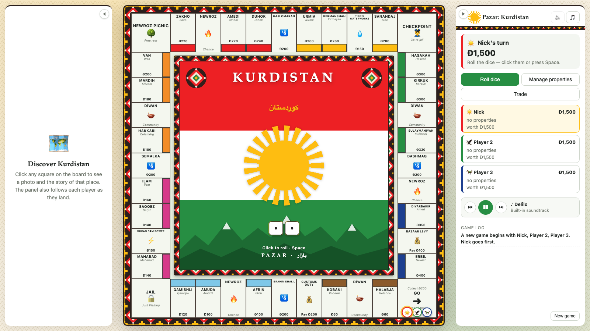
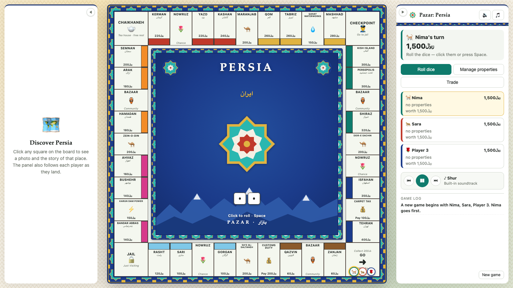
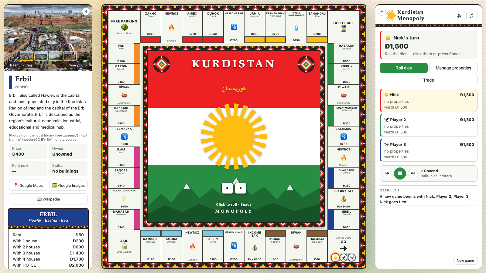

# Pazar · بازار

*The Silk Road trading game.* Buy, build and trade your way from city to city
in two themes: **Kurdistan** — Bashur (Iraq), Rojava (Syria), Rojhelat (Iran)
and Bakur (Turkey) — and **Persia**, the cities of Iran from the Caspian to the
Gulf. Plays entirely in your browser, on one computer, passing the mouse
between players (hot-seat). No install needed.

Pazar is an original property-trading game. It is not affiliated with or
endorsed by Hasbro.

| Kurdistan | Persia |
|---|---|
|  |  |

## Play

Double-click `play.command`. It starts a tiny local web server (`serve.py`,
Python, no dependencies) and opens the game at http://localhost:8765/. The
server is needed for YouTube music; everything else also works by opening
`index.html` directly:

```sh
open index.html
```

2–6 players. Pick a theme and your tokens on the start screen. The game saves
itself in the browser after every turn, so you can close the tab and resume
later. Saved games are kept per address, so a game saved from `index.html` is
not visible at the localhost address and vice versa.

## Controls

- Click the dice in the centre of the board, or press **Space** / **Enter**, to
  roll. After your move the same click or key ends your turn.
- Banners announce whose turn it is, the dice roll and where you landed; click a
  banner or press Space to skip it.
- Click any square and the left panel shows photos and the story of that place,
  its deed details, and buttons for Google Maps, Google Images and Wikipedia.
  The panel also follows each player as they land.
- Both side panels fold away with the arrow tab on their inner edge so the
  board can fill the window. The choice is remembered.
- The player bar in the side panel has Previous, Play/Pause and Next for
  whatever music is playing.



## Themes

Each theme is one file in `themes/` supplying the 40 squares, both card decks,
tokens, currency, colours, centre artwork, Google Maps and Wikipedia lookups,
offline blurbs, a YouTube starter list and a default soundtrack. Its photos live
in `images/<theme>/`.

**Kurdistan** (currency: dinar, Ð)

| Group | Region | Places |
|---|---|---|
| Brown | Towns | Halabja (Helebce), Kobani (Kobanê) |
| Light blue | Rojava · Syria | Afrin, Amuda, Qamishli |
| Pink | Rojhelat · Iran | Mahabad, Saqqez, Ilam |
| Orange | Bakur · Turkey | Hakkari (Colemêrg), Mardin, Van (Wan) |
| Red | Bashur · Iraq | Zakho, Amedi, Duhok |
| Yellow | Rojhelat · Iran | Urmia, Kermanshah, Sanandaj (Sine) |
| Green | Cities | Hasakah, Kirkuk, Sulaymaniyah |
| Dark blue | Capitals | Diyarbakir (Amed), Erbil (Hewlêr) |

Border crossings (Ibrahim Khalil, Semalka, Haji Omaran, Bashmaq) are the travel
squares; Dukan Dam Power and Tigris Waterworks are the utilities. The corners
are GO, Jail, the Newroz Picnic rest stop and the Checkpoint; the taxes are
Customs Duty and the Bazaar Levy. Cards are **Newroz** (chance) and **Dîwan**
(community).

**Persia** (currency: rial, ﷼)

| Group | Region | Places |
|---|---|---|
| Brown | Towns | Zanjan, Qazvin |
| Light blue | Caspian | Gorgan, Sari, Rasht |
| Pink | Gulf | Bandar Abbas, Bushehr, Ahvaz |
| Orange | Zagros | Hamadan, Arak, Semnan |
| Red | Desert | Kerman, Yazd, Kashan |
| Yellow | Holy & North | Qom, Tabriz, Mashhad |
| Green | Fars | Kish Island, Persepolis, Shiraz |
| Dark blue | Capitals | Isfahan, Tehran |

Silk Road caravanserais (Sa'd al-Saltaneh, Zein-o-din, Maranjab, Deir-e
Gachin) are the travel squares; Karun Dam Power and the Qanat Waterworks are
the utilities. The corners are GO, Jail, the Chaikhaneh rest stop and the
Checkpoint; the taxes are Customs Duty and the Carpet Tax. Cards are **Nowruz**
(chance) and **Bazaar** (community).

To add a theme, copy `themes/persian.js`, change the data, add a `<script>`
tag for it in `index.html`, and run `python3 images/build.py --theme <id>
--fetch` to download freely licensed photos for its places.

## Photos

The place panel shows photos from `images/<theme>/` first (they work offline),
then Wikipedia. The game ships with about 200 freely licensed photos from
Wikimedia Commons, credited in each folder's `credits.json`. You can add your
own pictures — see `images/README.md`. Optionally, *photo source* under the
panel text lets you add a free Google Custom Search API key to show Google
Images results for places without local photos.

## Sound and music

Sound effects are synthesized in the browser with the Web Audio API: dice,
footsteps, cash, cards, building, bidding, jail and a victory fanfare. Toggle
them with 🔊 in the side panel.

The 🎵 button opens the music menu, which has three sections:

- **Built-in soundtracks** — seven looping pieces synthesized live in
  traditional modes and dance forms: *Govend*, *Delîlo*, *Dengbêj*, *Halparke*
  and *Newroz* in Kurdish styles, and *Shur* and *Bandari* in Persian styles.
  They are original compositions in the style, not transcriptions of specific
  songs. Each theme picks its own default.
- **Real songs from YouTube** — streams through YouTube's own embedded player,
  so it needs an internet connection and the game served from localhost (use
  `play.command`). Each theme has a starter list of classics, and you can paste
  any YouTube video or playlist link to add it. Some uploads have embedding
  disabled by their owner; the menu says so and skips to the next track.
- **Your songs** — music from your own files. Click *Add songs from your Mac*
  or drag MP3 / M4A / WAV / FLAC files onto the game. Songs are stored in the
  browser (IndexedDB) and persist between sessions; nothing is uploaded. You
  can also drop files into the `music/` folder and run
  `./music/make-playlist.sh` (see `music/README.md`).

Pause, skip, set the volume and remove songs from the same menu. The chosen
track and volume are remembered. No recordings are bundled with the game.

## Rules implemented

- Standard rents, double rent for a complete colour group, houses and hotels
  with the even-build rule
- Mortgage / unmortgage (10% interest), selling buildings at half price
- Auctions when a player declines to buy (toggle at setup)
- Jail: roll doubles, pay the fine, or use a Get Out of Jail Free card; three
  doubles in a row sends you to jail
- Trading properties, cash and jail cards between players
- Debt handling and bankruptcy (assets go to the creditor or back to the bank);
  last player standing wins
- Optional house rule: taxes and fines collect at the rest-stop corner

## Files

- `index.html` – page structure
- `style.css` – board and UI styling
- `themes/` – one data file per theme (squares, cards, tokens, places, blurbs)
- `data.js` – theme loader
- `game.js` – rules engine and UI
- `audio.js` – sound effects, built-in soundtracks, song library
- `serve.py` / `play.command` – local no-cache web server and launcher
- `images/<theme>/` – photo libraries, with `images/build.py` to rebuild or refetch them
- `music/` – optional folder for your own audio files and the playlist helper
